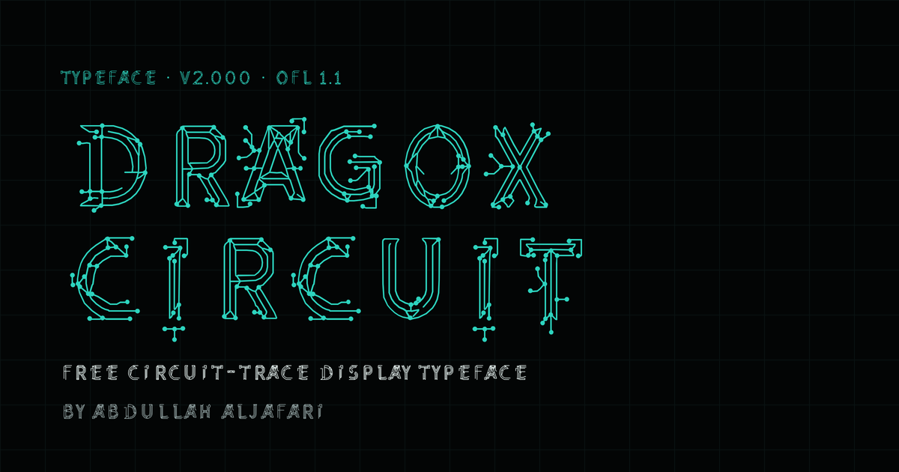

# Dragox Circuit



A free display typeface where every letter is a single traced line with junction nodes, like a route on a circuit board. Designed by **[Abdullah AlJafari](https://www.abdullah-aljafari.me)**. It was drawn by hand years ago, then rebuilt in Python as version 2.0.

This repository holds the font files, the Python pipeline that builds them, and the specimen website.

## Download

- **All files:** [`DragoxCircuit-2.000.zip`](public/fonts/dragox-circuit/DragoxCircuit-2.000.zip)
- **Single files:** [`public/fonts/dragox-circuit/`](public/fonts/dragox-circuit/)

| Family | Use | Files |
| --- | --- | --- |
| Dragox Circuit | Headlines and logos, 32px and up | `DragoxCircuit-Regular.ttf` / `.woff2` |
| Dragox Circuit Clean | Small text, 12–24px. Heavier lines, no nodes, hinted | `DragoxCircuitClean-Regular.ttf` / `.woff2` |

### Use it on the web

```css
@font-face {
  font-family: "Dragox Circuit";
  src: url("DragoxCircuit-Regular.woff2") format("woff2");
  font-display: swap;
}

h1 {
  font-family: "Dragox Circuit", sans-serif;
  font-feature-settings: "dlig" 1; /* A + J becomes the AJ monogram */
}
```

## What's in the font

- 148 glyphs: A–Z, small-capital a–z, digits, punctuation and kerning
- `ss01`: stub-free letters, without the extra circuit branches
- `dlig`: an AJ ligature
- a Clean companion family for small sizes

## How it was made

The scripts in [`sources/scripts/`](sources/scripts/) rebuild both families from the original v1 outlines in [`sources/original/`](sources/original/). The pipeline:

1. rasterises each letter and thins it to a one-pixel skeleton (scikit-image)
2. prunes stray branches from the skeleton graph (skan)
3. re-strokes the lines at one even width and keeps nodes only on outer edges (Shapely)
4. writes the fonts with OpenType features, then hints Clean (fontTools, ttfautohint)

```bash
pip install fonttools shapely scikit-image skan numpy pillow ttfautohint-py
python -P sources/scripts/build_font.py sources/original/DragoxCircuit-v1.ttf sources/original/logo.png build
python -P sources/scripts/export_specimen.py . build      # glyph data for the website
python -P sources/scripts/make_site_images.py .           # favicon and share image
```

## The website

A Next.js site with a live type tester, a glyph explorer and the build pipeline drawn step by step.

```bash
npm install
npm run dev     # http://localhost:3000
npm run build
```

## License

The fonts are licensed under the [SIL Open Font License 1.1](OFL.txt). You can use them for free in any project, including commercial ones, and embed them in websites and apps. You can't sell the font files on their own. Modified versions can't use the name "Dragox Circuit".

The website code and build scripts are © 2026 Abdullah AlJafari.
